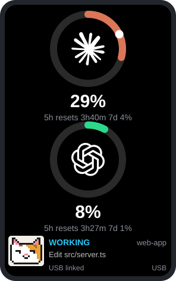
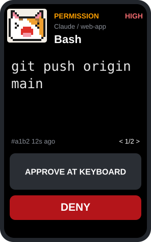
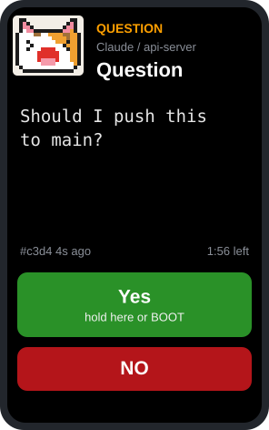
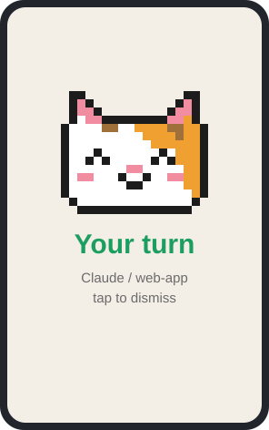
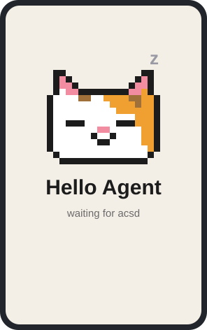
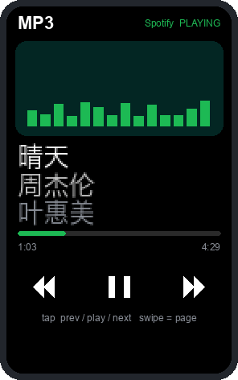

# Agent Control Surface

一块放在键盘旁的小屏幕：一眼看到 Claude 和 Codex 的用量与状态，并直接在设备上批准或拒绝 agent 的权限请求、回答它的问题。

## 工作原理

```
Claude Code / Codex  → hook →  acsd 守护进程（Mac）  → USB 串口 →  设备屏幕
```

agent 每次开始工作、调用工具、请求权限或结束一轮时，会调用 hook 脚本 `host/acs_hook.py`。脚本把事件交给 Mac 上常驻的 `acsd` 守护进程，守护进程通过 USB 把一份完整的状态快照发给设备。设备只负责显示和接收按键，所有判断都在主机上完成。用量数据来自 [Pulse](https://github.com/qunqin24/Pulse)，只读取它的缓存，不读取任何凭证。

## 支持的硬件

| | Seeed XIAO nRF52840 · 1.47" | Waveshare ESP32-S3 · 1.64" AMOLED |
|---|---|---|
| 屏幕 | IPS，172×320 | AMOLED，280×456 |
| 绘制方式 | 按原尺寸绘制 | 所有页面按原生分辨率绘制（布局为 XIAO 的 1.425 倍） |
| 按键 | USR1、USR2 | 只有 BOOT |
| 电量 | 电压估算，可显示充电 | 电压估算，无充电状态 |
| 编译刷写 | `firmware/build.sh xiao upload` | `firmware/build.sh amoled upload` |

两块板共用 `firmware/acs/acs.ino`，编译时按芯片类型选择 `board_xiao_nrf.h` 或 `board_amoled164.h`。AMOLED 的引脚取自 Waveshare 官方 v2 示例；第一版硬件的显示片选在 GPIO 9，编译时定义 `AMOLED_REV1` 即可。

## 屏幕

<table>
  <tr>
    <td align="center"><br>主屏</td>
    <td align="center"><br>权限请求</td>
    <td align="center"><br>回答问题</td>
    <td align="center"><br>轮到你了</td>
    <td align="center"><br>开机画面</td>
  </tr>
</table>

以上是 1.64" AMOLED（280×456）布局的示意图，不是实拍，由 `firmware/tools/readme_screens.py` 生成。

**主屏**（默认）：上面是 Claude，下面是 Codex，各一个用量圆环。弧线是 5 小时窗口的用量，从 12 点方向顺时针走；Claude 为橙色，到 90% 变红；Codex 按绿、橙、红变化。圆环下方是百分比、重置时间和 7 天用量。agent 工作时，一个白点沿圆环转圈。左下角的像素猫和文字显示最紧急的会话。读不到用量时显示灰色圆环和 `--`，不会显示成 0%。

**详情卡**：点圆环打开，列出每个用量窗口和该 agent 的会话；再点一下或 10 秒后返回。

**权限请求**（有请求时优先显示）：命令原文（不做摘要）、来自哪个会话（`#a1b2`）、出现了多久、队列位置 `< 1/2 >`。多个请求时左右滑动或点箭头切换，操作只作用于当前显示的请求。符合条件的 Claude Bash 命令会多出青色按钮 **Always / this session**：本会话内同一条命令不再询问，规则只存在内存里，会话结束即消失。

**回答问题**（仅 Claude）：Claude 的回复最后一行以问号结尾时，显示 Yes / No；Claude 使用多选提问工具时，显示 2 到 4 个选项，多个问题依次出现。问题挂在设备上时终端看不到它，所以最长等 2 分钟就交还给键盘。

**轮到你了**：会话做完或在等你输入时，全屏显示米白色卡片和开心的像素猫，点一下或按键关闭。它只是提醒，不会向 agent 发送内容。

**猫咪模式**：猫的表情跟随最紧急的会话：工作中、需要你、完成、空闲。

**开机画面**：等待守护进程时猫在睡觉；连上后显示 linked，1.5 秒后进入主屏。

## MP3 页



把 Mac 上 Spotify 桌面版正在播放的歌显示在设备上，思路来自 [pi-walkman](https://github.com/ysonggit/pi-walkman)。

- 显示窗里 14 根绿色频谱柱，播放时跳动，暂停时落到底。
- 歌名、歌手、专辑三行，使用 Unifont 点阵字体放大两倍，支持中日韩文字；一行放不下时单独滚动。专辑名和歌名重复（单曲）时不显示专辑。
- 进度条和时间；播放位置只在快进、切歌、暂停时由主机发送，其余由设备推算。
- 点屏幕左、中、右三块：上一首、播放或暂停、下一首。
- 进入方法：在主屏向右滑一次，或依次翻页（主屏 → Claude 详情 → Codex 详情 → 猫咪页 → MP3）。页面会一直停留，只有手动翻页才离开；权限请求会临时占据屏幕，处理完回到 MP3 页。
- 守护进程每秒用 AppleScript 读取 Spotify，读取前先确认它在运行，不会把它打开。第一次使用时 macOS 会询问是否允许 python3 控制 Spotify。
- 限制：只支持这台 Mac 上的 Spotify 桌面版；不显示封面；中文字体只在 AMOLED 上有（XIAO 只显示英文和数字），带字体的固件约 2.3 MB。

动图是按设备布局生成的示意图（`firmware/tools/readme_mp3_gif.py`），歌曲为示例。

<br clear="right">

## 操作方式

| 动作 | XIAO（USR1 / USR2） | AMOLED（BOOT + 触摸） |
|---|---|---|
| 批准 | 按住 USR1 0.8 秒，或按住绿色按钮 | 按住 BOOT 0.8 秒，或按住绿色按钮 |
| 本会话总是允许 | 按住青色按钮 1.5 秒 | 同左 |
| 拒绝 | 短按 USR2，或点 DENY | 点 DENY |
| 拒绝并停止 agent | 按住 USR2 1.5 秒，或按住 DENY 1.5 秒 | 按住 DENY 1.5 秒 |
| 回答 Yes / 选项 | 按住 0.8 秒 | 同左 |
| 问题交还键盘 | 多选题短按按键；是非题按住 DENY 1.5 秒 | 多选题短按 BOOT；是非题按住 DENY 1.5 秒 |
| 翻页（主屏 → Claude → Codex → 猫咪 → MP3） | 短按 USR2，或左右滑动 | 短按 BOOT，或左右滑动 |
| MP3 页：上一首 / 播放暂停 / 下一首 | 点屏幕左 / 中 / 右 | 同左 |
| 亮度 | 短按 USR1（无请求时） | 按住 BOOT 1.5 秒（无请求时） |

无操作 60 秒后调暗，90 秒后熄屏。熄屏时的第一次触摸或按键只用来唤醒。

**扣放免打扰**（AMOLED，使用板载 QMI8658 加速度计）：屏幕朝下扣放 1 秒，屏幕关闭，守护进程不再把请求发到设备，已在设备上的请求交还键盘；翻回正面即恢复。熄屏时拿起设备会自动亮屏。开机时默认设备是正面朝上放着的。XIAO 的陀螺仪暂未接入。

**防烧屏**（AMOLED）：整个画面每 3 分钟平移 2 到 4 个像素，避免圆环和文字长时间点亮同一批 OLED 像素。

## 安全规则

- 高风险命令（网络、`rm`、`sudo`、`git push`、命令替换、写项目外或凭证目录）和被截断的命令，设备上只能拒绝，批准必须回到键盘。主机端也会拒绝这类批准。
- 每个决定只能使用一次；请求 290 秒后过期。
- 在终端或桌面 App 里先回答了，设备上的请求会自动撤回，迟到的点击会被拒绝。
- 设备或守护进程不在线时，hook 立即返回，agent 照常在终端里询问。
- "本会话总是允许"只对 Claude、Bash、普通风险、完整显示的命令开放，规则不写入配置文件。

## 只显示部分来源

默认不在设备上显示 Claude 桌面 App 的会话（它们在 App 里自己弹窗）。要改，编辑 `~/.acs/config.json`，保存后立即生效：

```json
{"hide_sources": ["claude-desktop"]}
```

来源取自 Claude Code 的 `CLAUDE_CODE_ENTRYPOINT`：终端为 `cli`，桌面 App 为 `claude-desktop`；Codex 为 `codex`。设为 `[]` 显示全部。

## 已知限制

- `claude -p` 这类无界面运行不会触发权限 hook，无法在设备上审批。
- Codex 不支持"拒绝并停止"（退化为普通拒绝），也没有可在设备上回答的提问工具；新 hook 需要在 Codex 的 `/hooks` 里信任一次。
- 桌面 App 批准后，设备上的请求要等命令执行完才撤回。
- 除了权限请求时的"拒绝并停止"，没有可靠的方式从外部中断正在工作的 agent。
- 其他审批工具（Vibe Island、OpenIsland 等）也会收到同一个请求，谁先回答谁生效；Codex 只要有一个 hook 拒绝就按拒绝处理。

## 安装与使用

```bash
python3 host/install.py                  # 把 hook 写入 ~/.claude/settings.json 和 ~/.codex/hooks.json（先备份）
python3 host/install.py --uninstall      # 移除
```

守护进程作为 LaunchAgent 开机自启（`host/com.agentcontrolsurface.acsd.plist`，复制到 `~/Library/LaunchAgents`），崩溃后自动重启，日志在 `~/Library/Logs/acsd.log`。刷写固件时 `build.sh` 会自动暂停并重启它。

```bash
launchctl bootout gui/$(id -u)/com.agentcontrolsurface.acsd                                  # 停止
launchctl bootstrap gui/$(id -u) ~/Library/LaunchAgents/com.agentcontrolsurface.acsd.plist   # 启动
```

固件依赖 `arduino-cli`。XIAO 需要 Seeed nRF52 板包和 ArduinoJson，`build.sh` 会自动拉取 Seeed_GFX2；AMOLED 需要 Espressif ESP32 板包、ArduinoJson、GFX Library for Arduino 和 U8g2（中文字体）。

## 目录

- `host/acsd.py`：守护进程，Python 3 标准库，无第三方依赖。
- `host/acs_hook.py`：agent 调用的 hook。
- `host/install.py`：安装或卸载 hook。
- `host/test_e2e.py`：端到端测试（真实守护进程 + hook + 模拟设备）。
- `host/demo.py`、`host/demo2.py`：在真实设备上逐屏演示。
- `sim/device_sim.py`：终端里的设备模拟器。
- `firmware/`：设备固件、`build.sh`、图标和像素猫生成脚本（`tools/`）；`tools/readme_screens.py` 和 `tools/readme_mp3_gif.py` 生成 README 里的屏幕示意图和动图。
- `docs/PROTOCOL.md`：设备协议；`docs/DESIGN.md`：界面设计。

## 测试

```bash
python3 host/test_e2e.py
```

已对照 Claude Code 2.1.185 验证：终端权限对话框与 `PermissionRequest` hook 并行运行，谁先回答谁生效；键盘先回答时 Claude Code 会结束 hook，守护进程随即撤回设备上的请求。`deny` 加 `interrupt: true` 能停止 agent；`PreToolUse` 返回 `continue: false` 不是可靠的中断方式。

## 致谢

- 界面风格参考 [Pulse](https://github.com/qunqin24/Pulse)（qunqin24，Apache-2.0）。
- Claude 与 OpenAI 图标来自 [Lobe Icons](https://github.com/lobehub/lobe-icons)（MIT），经 Pulse 打包。商标归各自所有者，使用仅为标明兼容的服务，不代表背书。
